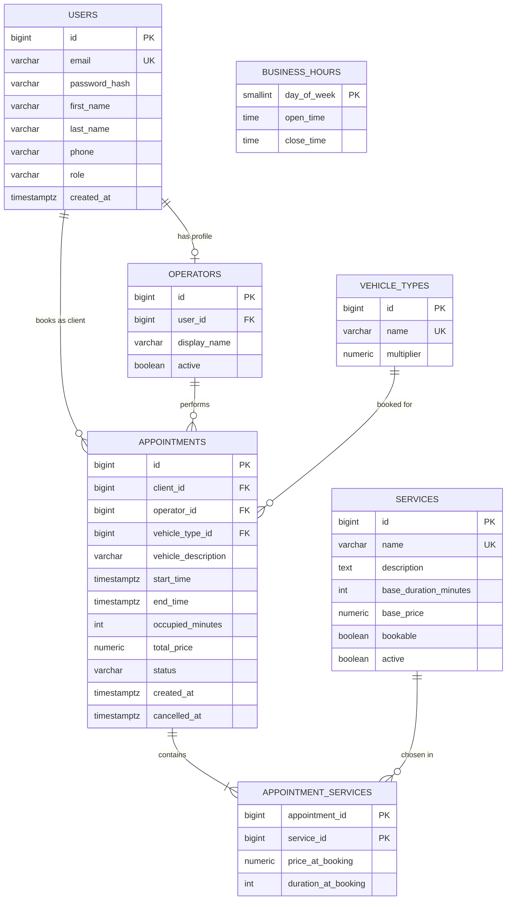

# Data Model

Entity-relationship diagram for the car wash booking system.

## Notes

- **Price/duration snapshot:** `appointment_services` stores the price and duration at booking time, so later catalog changes do not alter past appointments.
- **Money:** stored as `numeric` (`BigDecimal` in Java), `double` leads to rounding errors.
- **Time:** stored as `timestamptz`; slot generation uses the `Europe/Bucharest` time zone.
- **Concurrency:** a PostgreSQL exclusion constraint on (`operator_id`, time range) prevents overlapping appointments at the database level.
